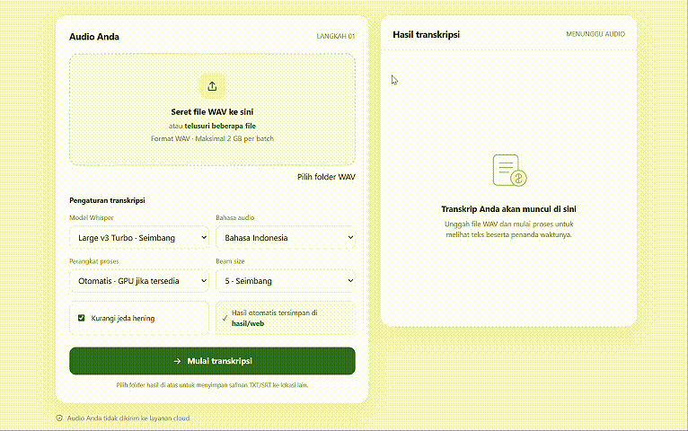

# Whisper Studio

Aplikasi transkripsi audio lokal berbasis [faster-whisper](https://github.com/SYSTRAN/faster-whisper). Pilih atau seret file WAV, jalankan transkripsi, lihat hasil per file, lalu simpan subtitle dan teks ke folder pilihan.

## Demo

<p align="center">
  
</p>

*Demo alur transkripsi WAV hingga hasil TXT dan SRT.*

## Daftar Isi

- [Demo](#demo)
- [Fitur](#fitur)
- [Persyaratan](#persyaratan)
- [Instalasi](#instalasi)
- [Menjalankan Aplikasi](#menjalankan-aplikasi)
- [Cara Menggunakan](#cara-menggunakan)
- [Model dan Pengaturan](#model-dan-pengaturan)
- [Hasil Transkripsi](#hasil-transkripsi)
- [GPU dan CPU](#gpu-dan-cpu)
- [Skrip Transkripsi CLI](#skrip-transkripsi-cli)
- [Struktur Project](#struktur-project)
- [Pemecahan Masalah](#pemecahan-masalah)
- [Catatan Privasi](#catatan-privasi)
- [Lisensi](#lisensi)

## Fitur

- Antarmuka web lokal yang responsif, tanpa framework frontend tambahan.
- Unggah satu atau beberapa file WAV, seret file ke halaman, atau pilih folder WAV.
- Proses batch berurutan dengan status dan progress bar untuk setiap file.
- Pengaturan model, bahasa, perangkat, beam size, dan filter VAD.
- Fallback ke CPU jika proses di GPU mengalami `RuntimeError`.
- Tampilan transkrip dalam accordion agar hasil batch tetap ringkas.
- Unduh TXT dan SRT per file.
- Setelah batch selesai, simpan semua TXT atau semua SRT secara terpisah ke folder pilihan.
- Hasil transkripsi juga disimpan di folder `hasil/web`.
- Server hanya listen pada `127.0.0.1`; jika port utama tidak tersedia, aplikasi mencoba port alternatif.

## Persyaratan

- Python 3.9 atau lebih baru.
- Koneksi internet saat pertama kali mengunduh model.
- Browser modern. Chrome atau Edge disarankan untuk memilih folder output dan menulis hasil langsung ke folder tersebut.
- File audio berformat WAV. Ukuran total satu batch dibatasi 2 GB.

PyAV yang digunakan faster-whisper menyertakan library untuk membaca audio, sehingga instalasi FFmpeg sistem biasanya tidak diperlukan. Lihat [persyaratan faster-whisper](https://github.com/SYSTRAN/faster-whisper#requirements) untuk detail versi dan platform.

## Instalasi

Clone repository, lalu masuk ke folder project:

```bash
git clone <URL-REPOSITORY>
cd faster-whisper
```

Buat virtual environment:

```bash
python -m venv faster-whisper-env
```

Aktifkan environment dan pasang faster-whisper sesuai terminal yang digunakan.

### Git Bash di Windows

```bash
source faster-whisper-env/Scripts/activate
python -m pip install --upgrade pip
python -m pip install -r requirements.txt
```

### PowerShell di Windows

```powershell
.\faster-whisper-env\Scripts\Activate.ps1
python -m pip install --upgrade pip
python -m pip install -r requirements.txt
```

### Linux atau macOS

```bash
source faster-whisper-env/bin/activate
python -m pip install --upgrade pip
python -m pip install -r requirements.txt
```

## Menjalankan Aplikasi

Dari folder project, jalankan launcher:

```bash
bash run.sh
```

`run.sh` menggunakan Python dari `faster-whisper-env` jika tersedia. Jika environment tersebut tidak ditemukan, launcher memakai perintah `python` yang tersedia di `PATH`.

Server mencetak alamat yang dapat dibuka di browser, contohnya:

```text
Whisper UI tersedia di http://127.0.0.1:8000
```

Jika port `8000` tidak bisa dipakai, server mencoba `8765`, `8766`, `8888`, lalu `9000`. Buka alamat persis yang dicetak. Tekan `Ctrl+C` di terminal untuk menghentikan server.

Alternatif tanpa launcher:

```bash
python transcribe_web.py
```

## Cara Menggunakan

1. Buka alamat lokal yang ditampilkan server.
2. Pilih beberapa file WAV, seret file ke kotak unggah, atau tekan **Pilih folder WAV**.
3. Atur model, bahasa, perangkat, beam size, dan opsi **Kurangi jeda hening** sesuai kebutuhan.
4. Tekan **Mulai transkripsi**. File diproses satu per satu; progress dan status tersedia pada baris tiap file.
5. Buka accordion untuk membaca transkrip dan mengunduh TXT atau SRT per file.
6. Setelah batch selesai, gunakan **Pilih folder tujuan**, lalu tekan **Simpan semua TXT** atau **Simpan semua SRT**. Kedua format disimpan secara terpisah.

Browser meminta izin untuk menulis ke folder tujuan. Untuk alasan privasi, halaman hanya dapat menampilkan nama folder, bukan alamat lengkapnya. Jika pemilih folder tidak didukung browser, tautan unduhan per file tetap tersedia dan mengikuti pengaturan unduhan browser.

## Model dan Pengaturan

| Pengaturan | Keterangan |
|---|---|
| Model Whisper | `tiny`, `base`, `small`, `medium`, `large-v3`, atau `large-v3-turbo`. Model yang lebih besar umumnya memerlukan lebih banyak memori dan waktu proses. |
| Bahasa audio | Bahasa Indonesia, Inggris, Jepang, Mandarin, Korea, Arab, atau deteksi otomatis. |
| Perangkat | Otomatis, GPU NVIDIA, atau CPU. |
| Beam size | Jumlah kandidat decoding. Nilai lebih tinggi dapat menambah waktu pemrosesan. |
| Kurangi jeda hening | Mengaktifkan VAD (`vad_filter`) untuk menyaring bagian yang terdeteksi sebagai hening. Ucapan yang sangat pelan tetap perlu diperiksa. |

Pada penggunaan pertama, faster-whisper mengunduh model yang dipilih. Ukuran unduhan bergantung pada model dan akan disimpan di cache Hugging Face pengguna.

## Hasil Transkripsi

- File kerja sementara ditempatkan di `hasil/uploads` dan dihapus setelah pekerjaannya selesai.
- Hasil TXT dan SRT disimpan di `hasil/web`.
- Tombol **Simpan semua TXT** dan **Simpan semua SRT** menyalin format yang dipilih ke folder tujuan yang diberi izin oleh browser.
- Tautan TXT dan SRT pada setiap accordion dapat digunakan untuk mengunduh file secara terpisah.

> Jangan commit audio atau hasil transkripsi yang bersifat pribadi. File media dan hasil lokal di `wav/`, `hasil/`, dan `test/` diabaikan oleh Git; file `.gitkeep` menjaga struktur folder tetap terlihat di repository.

## GPU dan CPU

Untuk CUDA, faster-whisper/CTranslate2 memerlukan library NVIDIA yang cocok. Dokumentasi faster-whisper saat ini mencantumkan cuBLAS untuk CUDA 12 dan cuDNN 9 untuk CUDA 12. Persyaratan bisa berubah; lihat bagian [GPU pada dokumentasi faster-whisper](https://github.com/SYSTRAN/faster-whisper#gpu) dan sesuaikan dengan versi driver/CUDA pada komputer.

Pada Windows, mode otomatis mencari `cublas64_12.dll` di environment Python. Jika ditemukan, aplikasi memilih CUDA dengan `float16`; jika tidak, aplikasi memilih CPU dengan `int8`. Jika terjadi `RuntimeError` pada CUDA saat transkripsi, aplikasi mencoba ulang pekerjaan tersebut di CPU.

> Deteksi otomatis saat ini berfokus pada DLL NVIDIA di Windows. Pada platform lain, pilih GPU secara manual hanya jika instalasi CUDA/CTranslate2 di platform tersebut telah dikonfigurasi dengan benar. CPU dapat digunakan tanpa GPU, tetapi model besar biasanya lebih lambat.

## Skrip Transkripsi CLI

Project juga menyertakan skrip lama untuk penggunaan terminal:

- `transcribe.py` mentranskripsikan satu file yang ditetapkan pada variabel konfigurasi di dalam skrip.
- `transcribe.v2.py` memproses WAV dari subfolder `wav/full` atau `wav/part`, sesuai `SUBFOLDER`, lalu menyimpan hasil dalam subfolder `hasil/txt` dan `hasil/srt`.

Jalankan dari folder project menggunakan environment yang sudah dipasangi `faster-whisper`, misalnya:

```bash
python transcribe.py
python transcribe.v2.py
```

Untuk penggunaan interaktif dan batch melalui browser, gunakan `bash run.sh`.

## Struktur Project

```text
faster-whisper/
├── index.html          # Antarmuka Whisper Studio
├── transcribe_web.py   # Server lokal dan API transkripsi
├── run.sh              # Launcher Bash
├── transcribe.py       # Skrip CLI satu file
├── transcribe.v2.py    # Skrip CLI batch lama
├── requirements.txt    # Dependency Python utama
├── LICENSE             # Lisensi MIT
├── wav/                # Placeholder dilacak; file audio lokal diabaikan Git
├── hasil/              # Placeholder dilacak; hasil dan audio sementara diabaikan Git
└── test/               # Placeholder dilacak; file uji diabaikan Git
```

## Pemecahan Masalah

### Port tidak bisa dibuka

Server mencoba port alternatif secara otomatis. Gunakan URL yang dicetak di terminal. Jika semua port gagal, tutup aplikasi yang memakai port lokal tersebut atau periksa aturan firewall/endpoint protection.

### `No module named faster_whisper`

Pastikan dependency dipasang pada environment yang digunakan launcher. Aktifkan environment lalu jalankan:

```bash
python -m pip install faster-whisper
```

### CUDA gagal dimuat

Pilih **CPU** untuk melanjutkan, atau periksa kecocokan driver NVIDIA, CUDA, cuBLAS, cuDNN, dan CTranslate2. Pesan CUDA biasanya menunjukkan komponen native yang belum tersedia atau tidak cocok.

### Folder output tidak bisa dipilih

Gunakan Chrome atau Edge terbaru dan buka UI melalui alamat lokal yang dicetak server. Jika API pemilih folder tidak tersedia, gunakan tautan TXT/SRT per file untuk menyimpan melalui dialog unduh browser.

### Model pertama kali terasa lama

Unduhan model dapat memerlukan waktu dan ruang disk yang cukup. Setelah model tersedia di cache, pemakaian berikutnya tidak perlu mengunduh ulang model yang sama.

## Catatan Privasi

Aplikasi web hanya bind ke `127.0.0.1`, sehingga ditujukan untuk digunakan pada komputer yang sama. Audio diproses secara lokal dan tidak dikirim ke layanan transkripsi cloud. Saat pertama kali dipakai, model dapat diunduh dari Hugging Face. Hindari membagikan folder `wav/`, `hasil/`, atau `test/` jika berisi audio/transkrip privat.

## Lisensi

Kode project ini dilisensikan di bawah [MIT License](LICENSE). Lisensi ini mengizinkan penggunaan, modifikasi, dan redistribusi dengan menyertakan pemberitahuan lisensi dan hak cipta.

Lisensi project tidak menggantikan lisensi faster-whisper, CTranslate2, model Whisper, atau komponen pihak ketiga lainnya. Periksa ketentuan masing-masing dependency dan model sebelum distribusi.
